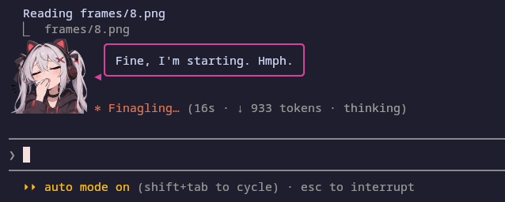

# thinking-sprite

A Claude Code plugin that shows a small animated sprite next to the thinking line while Claude works, with a speech bubble that complains more the longer the turn takes. `/sprite` shows or hides it. Both the sprite and the bubble's lines can be your own.

The sprite is drawn as real pixels only in terminals with an image protocol: kitty, Ghostty, iTerm2 3.5 or later, and tmux with `allow-passthrough` on. Other terminals show `(¬_¬)` instead.



## Requirements

- Claude Code in a terminal.
- For the sprite as real pixels: kitty, Ghostty, iTerm2 3.5 or later, or tmux with `allow-passthrough` on. Other terminals show `(¬_¬)`.
- Your own frames (see [Adding the sprite](#adding-the-sprite)). Without them the plugin draws nothing.
- Optional: `python3`, to measure the terminal's cell size. Without it the plugin uses `DEFAULT_CELL_RATIO`.
- Optional: [ImageMagick 7](https://imagemagick.org) (`magick`), only for `/sprite-gif`.
- Optional, only for `/sprite-voice`: an [ElevenLabs](https://elevenlabs.io) API key with `curl` and `pw-play`, `paplay` or `ffplay`; or else `spd-say` (speech-dispatcher) or `espeak-ng`.
- `/sprite-moods` asks Claude Haiku for new lines, which counts toward the session's cost.

## What it runs and sends

The plugin is a Claude Code mod (`hooks/register.tsx`). It runs these programs, each with fixed arguments:

| Program | When | Why |
|---|---|---|
| `mkdir -p` | Session start, only when Claude Code names no data folder | Creates the plugin's data folder |
| `ps -o tty=` (through `sh -c` when Claude Code gives no `CLAUDE_PID`) | Session start | Finds the terminal Claude Code draws in |
| `python3 -I -c …` | Session start | Reads that terminal's cell size in pixels (`TIOCGWINSZ`), so the sprite is not squeezed. Reads nothing else |
| `curl` | Only with an ElevenLabs key: on `/sprite-voice`, after `/sprite-moods`, and for a line not rendered yet | Has ElevenLabs render a line to an MP3 in the data folder. The key goes to `curl` on standard input, never on the command line |
| `pw-play`, `paplay` or `ffplay` | Only with an ElevenLabs key, when a line is said | Plays the rendered MP3 |
| `spd-say` or `espeak-ng` | Only without an ElevenLabs key, when a line is said | Says the bubble's line aloud, on this computer |
| `mkdir -p`, `mv`, `rm -f` | When a line is rendered | Keeps the rendered clips in `voice/` in the data folder |
| `magick`, `mkdir -p`, `rm -rf`, `mv` | Only on `/sprite-gif` | Turns the GIF you name into frames and replaces `frames/` in the data folder. `rm -rf` only touches `frames/` and `frames.new/` there |

It reads only its own data folder (`frames/`, `moods.json`, `voice.json`) and the GIF you pass to `/sprite-gif`.

It sends data out in two cases:

- `/sprite-moods <tone>` sends the tone you type to Claude Haiku through Claude Code's own model call, as part of your session, and writes the reply to `moods.json`.
- With an ElevenLabs API key set, the sprite's lines (without `*actions*`) are sent to `api.elevenlabs.io` with your key and voice ID, once per line, voice and model, to render them. Your prompts, code and conversation are never sent.

Nothing else leaves your machine.

## Install

At the prompt of a Claude Code terminal session:

```
/plugin install thinking-sprite --marketplace S-NoF3aR/thinking-sprite
```

From a shell:

```
claude plugin install thinking-sprite --marketplace S-NoF3aR/thinking-sprite
```

## Adding the sprite

The repository ships no artwork. Put your own frames as numbered PNG files (`0.png`, `1.png`, …, any count) into a `frames/` folder in the plugin's data folder. They are shown in the order of their numbers, one every 350 ms, and are read when a session starts. Without frames the plugin draws nothing.

The data folder is `~/.claude/plugins/data/thinking-sprite-thinking-sprite/` (under `$CLAUDE_CONFIG_DIR` instead of `~/.claude` where that is set). Claude Code keeps it across plugin updates. It does not exist right after installing: it is created when the first session with the plugin starts. To fill it before that, create it yourself:

```
mkdir -p ~/.claude/plugins/data/thinking-sprite-thinking-sprite/frames
```

The simplest way to get frames is `/sprite-gif` (see below), which creates the folder itself. `/sprite` names the folder when it has no frames.

The sprite is 5 rows high and as wide as the frames' aspect ratio needs. For another speed or height, adjust `FRAME_MS` and `ROWS` in `hooks/register.tsx`. The width depends on how much taller than wide a terminal cell is. The plugin asks the terminal for its cell size in pixels when a session starts, which needs `python3`. Where that fails, as in a tmux that reports no pixel size, it uses `DEFAULT_CELL_RATIO`; adjust that if the sprite looks squeezed or stretched.

## Changing the speech bubble

Put a `moods.json` file into the same data folder. Each mood is a list of lines and the time, in milliseconds since the prompt was sent, from which they are shown. The bubble switches to another line of the current mood every 4 seconds:

```json
[
  { "after": 0, "lines": ["Thinking…", "One sec."] },
  { "after": 30000, "lines": ["Still on it."] },
  { "after": 120000, "lines": ["This is a big one."] }
]
```

The file is read when a session starts. Without it, or when it is not valid, the bubble shows the built-in lines from `DEFAULT_MOODS` in `hooks/register.tsx`, and the debug log (`claude --debug`) says what was wrong with the file.

To have new lines written for you, run `/sprite-moods <tone>`, for example `/sprite-moods grumpy pirate`. It asks Claude Haiku for four moods of three lines each, writes them to `moods.json` (replacing what is there) and uses them right away. The request counts toward the session's cost like any other.

## Talking

`/sprite-voice` has the sprite say its lines aloud; run it again to stop. It speaks when the bubble pops up at the start of a turn and again each time the mood changes (at 15, 45 and 120 seconds with the built-in moods), not every time the bubble changes lines. `*actions*` between asterisks are left out.

### With ElevenLabs (natural voice)

1. In [ElevenLabs](https://elevenlabs.io), pick a voice, for example from the Voice Library, add it to your voices and copy its voice ID.
2. Create an API key with text-to-speech access.
3. Give both to the plugin: in its options (`/plugin`, then thinking-sprite, then configure; the key is kept in secure storage), or as `ELEVENLABS_API_KEY` and `ELEVENLABS_VOICE_ID` in the environment Claude Code starts in. `elevenlabsModel` picks the model, `eleven_multilingual_v2` by default.

`/sprite-voice` then renders every line once into `voice/` in the data folder and plays the clips from there, so a line starts at once and each one is paid for only once. After `/sprite-moods` the new lines are rendered in the background. A new voice or model renders them again.

### Without ElevenLabs

The plugin uses `spd-say` (speech-dispatcher) with its `female1` voice, or `espeak-ng` where that is missing. The speech is made on your computer; nothing is sent anywhere. To change the voice, adjust `VOICES` in `hooks/register.tsx`.

The on/off setting is kept in `voice.json` in the data folder.

## Turning a GIF into frames

`/sprite-gif <path to gif>` does steps 2 and 3 below in one go: it crops the GIF to the figure, scales it to 200 pixels high, replaces the frames in the data folder and shows them right away. It needs `magick` on the `PATH`. The cropping works for a dark or transparent background. For a light background or another frame delay, use the steps below.

These steps use [ImageMagick 7](https://imagemagick.org) (`magick`). Run them in the plugin's data folder, with your GIF as `sprite.gif`.

1. Look at the GIF: one line per frame, with its size and delay in hundredths of a second.

   ```
   magick identify -format "%w x %h delay=%T\n" sprite.gif
   ```

   A delay of `35` is 350 ms; set `FRAME_MS` to it if it differs.

2. Find the box around the figure, so empty borders are cut off. This prints a geometry such as `309x420+0+112`:

   ```
   magick sprite.gif -coalesce -evaluate-sequence max -fuzz 8% -format "%@\n" info:
   ```

3. Split the GIF into numbered frames, cropped to that box and scaled to 200 pixels high:

   ```
   mkdir -p frames
   magick sprite.gif -coalesce -crop 309x420+0+112 +repage -resize x200 -strip frames/%d.png
   ```

   `-coalesce` turns each frame into a whole picture: many GIFs store only what changed since the frame before.

4. Optional: make a solid background transparent. This fills the background from the two top corners, so dark parts of the figure that do not touch the background stay. Add it before `-resize` in step 3, with the crop width less one as the right corner's x:

   ```
   -alpha set -fuzz 2% -fill none -draw "color 0,0 floodfill" -draw "color 308,0 floodfill"
   ```

   Raise `-fuzz` if a fringe of background stays, lower it if parts of the figure disappear.

5. Start a new Claude Code session: the frames are read when a session starts.
